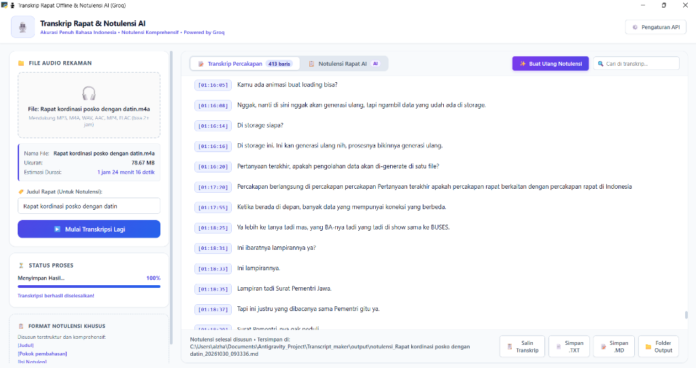

<div align="center">

# 🎙️ Transkrip Rapat & Notulensi AI (Groq Whisper)

**Aplikasi Desktop Modern untuk Mengubah Rekaman Rapat Offline & Audio Menjadi Transkrip Lengkap Serta Notulensi Komprehensif Berbahasa Indonesia.**

[](https://www.python.org/)
[](https://groq.com/)
[](https://pywebview.flowrl.com/)
[](LICENSE)

---

### 📸 Tampilan Aplikasi



</div>

---

## ✨ Fitur Unggulan

1. **🎙️ Transkripsi Super Cepat & Akurat (Bahasa Indonesia)**
   - Didukung oleh model **OpenAI Whisper (Large-v3)** yang berjalan di atas chip **Groq LPU**, menghasilkan kecepatan transkripsi hitungan detik.
   - Sangat fasih mengenali Bahasa Indonesia formal rapat, percakapan santai, maupun istilah kerja serapan bahasa Inggris.

2. **⏱️ Penanda Waktu (Timestamp) Rapi Per Kalimat**
   - Setiap ucapan otomatis diberi *timestamp* `[HH:MM:SS]` dan dipisahkan baris baru dengan rapi:
     ```text
     [01:16:05] Kamu ada animasi buat loading bisa?
     [01:16:08] Nggak, nanti di sini nggak akan generasi ulang...
     [01:16:14] Di storage siapa?
     ```
   - 100% *verbatim*, tidak ada pemotongan atau penghilangan kata.

3. **⏳ Dukungan File Audio Panjang (2 Jam atau Lebih)**
   - Audio rapat berdurasi panjang otomatis dipecah menjadi potongan 10 menit di memori, menjamin terbebas dari limit *upload* 25 MB di Groq Free Tier.
   - Waktu global rapat tetap terjaga secara berkesinambungan dari menit awal hingga akhir.

4. **📋 Notulensi Rapat Komprehensif Khusus (On-Demand AI)**
   - Saat diinginkan, AI dapat menyusun notulensi rapat dengan format terstruktur baku:
     - **`[Judul]`** : Judul rapat yang diambil dari form input Anda.
     - **`[Pokok pembahasan]`** : Agenda dan topik utama yang didiskusikan.
     - **`[Isi Notulen]`** : Pembahasan mendalam, detail laporan, kendala, data/angka, dan argumen peserta.
     - **`[Kesimpulan]`** : Keputusan strategis bersama serta *action items* / tindak lanjut.
   - Bersifat **manual (*on-demand*)**: Notulensi baru dibuat jika Anda menekan tombol **`✨ Buat Notulensi AI`** agar kuota token Groq Anda tidak terbuang sia-sia.

5. **🧠 Hierarchical Summarization (Anti Error 413 / Rate Limit)**
   - Rapat panjang (10.000+ token) diringkas secara berjenjang sehingga tidak akan pernah terkena limit *Tokens Per Minute (TPM)* di Groq Free Tier.

6. **💻 Desain UI/UX Pro Max (Modern Light Mode & Responsif)**
   - Antarmuka desktop elegan bertema *Modern Light Mode* (terinspirasi dari Stripe, Linear, dan Notion).
   - Layout fleksibel dan responsif di berbagai resolusi layar jendela tanpa terpotong.
   - Dilengkapi fitur **Pencarian (*Search Bar*)**, tombol **Salin Cepat**, ekspor ke **`.TXT`**, dan format **`.MD`** (Markdown).
   - Seluruh hasil otomatis tersimpan di folder `output/`.

---

## 🎧 Format Audio yang Didukung

Aplikasi secara otomatis menangani berbagai format media melalui *bundled* FFmpeg:
* `.mp3`
* `.m4a` *(format rekaman bawaan HP / iPhone / Voice Recorder)*
* `.wav`
* `.aac`
* `.mp4` / `.m4v` *(video rapat langsung diekstrak audionya)*
* `.flac`
* `.ogg`

---

## 🚀 Panduan Memulai

### 1. Prasyarat
* Sistem Operasi: Windows 10 atau Windows 11
* Python 3.10 atau versi lebih baru
* Akun Groq gratis di [console.groq.com](https://console.groq.com) (tanpa kartu kredit)

### 2. Instalasi Dependensi
Buka terminal / Command Prompt di folder proyek, lalu jalankan:
```bash
pip install -r requirements.txt
```

### 3. Konfigurasi API Key
* Buka file `config.json` (atau gunakan menu **⚙️ Pengaturan API** di dalam aplikasi).
* Masukkan API Key Groq Anda yang diawali `gsk_...`:
  ```json
  {
    "api_key": "gsk_XXXXXXXXXXXXXXXXXXXXXXXX",
    "model": "whisper-large-v3",
    "language": "id",
    "chunk_minutes": 10
  }
  ```
*(Catatan: File `config.json` otomatis diamankan oleh `.gitignore` sehingga kunci API Anda tidak akan pernah terunggah ke Git).*

---

## 🖥️ Cara Menjalankan Aplikasi

Cara paling praktis adalah dengan **klik dua kali (double-click)** file:
```text
run.bat
```
*(Atau via terminal: `python main.py`)*

### Alur Penggunaan:
1. Klik area **File Audio Rekaman** untuk memilih file audio rapat.
2. Masukkan **Judul Rapat** pada form yang tersedia (opsional, untuk penamaan notulensi).
3. Klik tombol biru **▶️ Mulai Transkripsi**.
4. Pantau progres transkripsi secara *live*.
5. Setelah transkrip selesai, baca atau salin teks percakapan.
6. Jika membutuhkan notulensi terstruktur, klik tombol ungu **`✨ Buat Notulensi AI`** di kanan atas.

---

## 📂 Struktur Proyek

```text
transcript-maker/
├── assets/
│   └── preview.png          # Tangkapan layar antarmuka aplikasi
├── output/                  # Folder penyimpanan otomatis file transkrip & notulensi
├── web/
│   ├── index.html           # Struktur antarmuka PyWebView
│   ├── style.css            # Desain UI/UX Modern Light Mode & Responsif
│   └── app.js               # Logika antarmuka & jembatan API JavaScript
├── config.example.json      # Templat konfigurasi
├── main.py                  # Entry point aplikasi desktop PyWebView
├── transcriber.py           # Engine Whisper & Hierarchical Notulensi Groq
├── requirements.txt         # Daftar pustaka Python
├── run.bat                  # Pintasan sekali klik untuk Windows
└── README.md                # Dokumentasi proyek
```

---

## 📄 Lisensi

Proyek ini didistribusikan di bawah lisensi **MIT**. Silakan gunakan dan kembangkan sesuai kebutuhan Anda.
